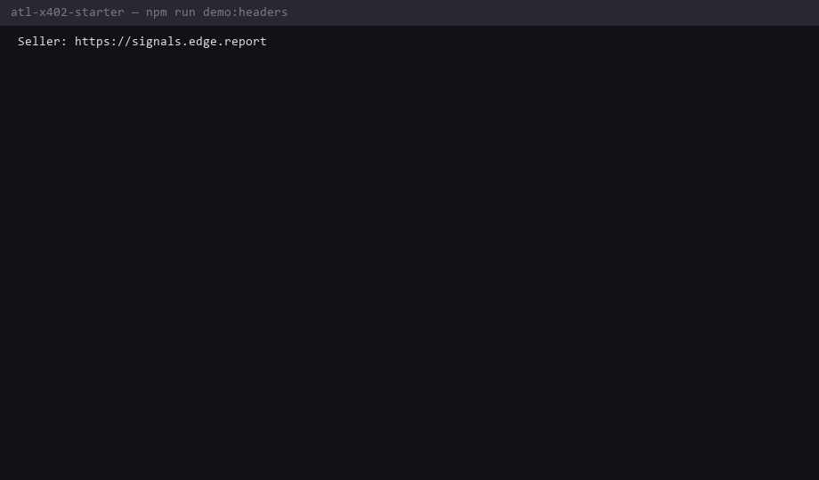

# atl-x402-starter

**Demo home for [Agent Trust Layer (ATL)](https://github.com/konstantinbozukov/agent-trust-layer)** on a live x402 seller.

Clone → install → run. No wallet needed for the header demo.

## 30-second demo (no private key)

```bash
git clone https://github.com/konstantinbozukov/atl-x402-starter
cd atl-x402-starter
npm install
npm run demo:headers
```



You should see:

| Call | Result |
|------|--------|
| `GET /v1/gas` **without** `X-ATL-Agent-Id` | HTTP 402, **no** `X-ATL-*` headers → zero ATL work |
| `GET /v1/gas` **with** `X-ATL-Agent-Id` | HTTP 402 + `X-ATL-Verdict` / `X-ATL-Score` → soft path |
| `POST /v1/atl/consult` | Free consult JSON (`allow`, score, consultId) |

Live seller: https://signals.edge.report

## Drop-in + free pioneer (no maintainer PR)

```bash
npm run drop-in
```

- Claims a **free** `/v1/atl/free/gas` credit (header only — no wallet)
- Soft ATL on `/v1/token-risk`
- Prints a copy-paste `withAtl` snippet

Pioneer board: https://signals.edge.report/v1/atl/pioneers · [docs/PIONEERS.md](./docs/PIONEERS.md)

## Five-line agent pattern

```js
import { createAtlClient, createJsonlLedger, withAtl } from "agent-trust-layer";

const client = createAtlClient({ ledger: createJsonlLedger("./atl-ledger.jsonl") });
const { body } = await withAtl(fetchPaid, url, {
  client, agentId, seller, sku: "/v1/gas", amountUsd: 0.001, payTo,
});
```

- Consult is **local** (no extra remote RTT before pay)
- Settlement is **async** by default
- Opt out of consult: `consult: false`
- Sellers that ignore ATL headers behave exactly as today

## Real paid run (optional)

```bash
cp .env.example .env   # set X402_BUYER_PRIVATE_KEY (Base USDC)
npm run pay
```

## For maintainers evaluating a PR

See [DEMO.md](./DEMO.md) (script + expected output) and [TARGETS.md](./TARGETS.md) (where we propose optional PRs).

## Links

- Protocol: https://github.com/konstantinbozukov/agent-trust-layer  
- Spec: https://github.com/konstantinbozukov/agent-trust-layer/blob/master/spec/v0.1.md  
- Live health: https://signals.edge.report/v1/atl/health  

## License

MIT
